# NextRound


Plan your workout. Run the clock. Track your progress.

NextRound is an offline workout timer and planner for **Apple Silicon Macs running macOS 14 or later**. No account is required. Workouts, personal exercises, preferences and saved results stay on your Mac.

**Current release: 2.5.0.** [Download for macOS](https://github.com/StormKiln/NextRound/releases/latest) · [Release notes](docs/release-notes-2.5.0.md) · [Privacy policy](PRIVACY.md)

## Assemble a session from saved workouts

Choose several saved workouts, preview their timing and movements, then arrange the selected order before adding independent copies to your session. Search, type and favourite filters help find routines. One Undo removes the whole batch.

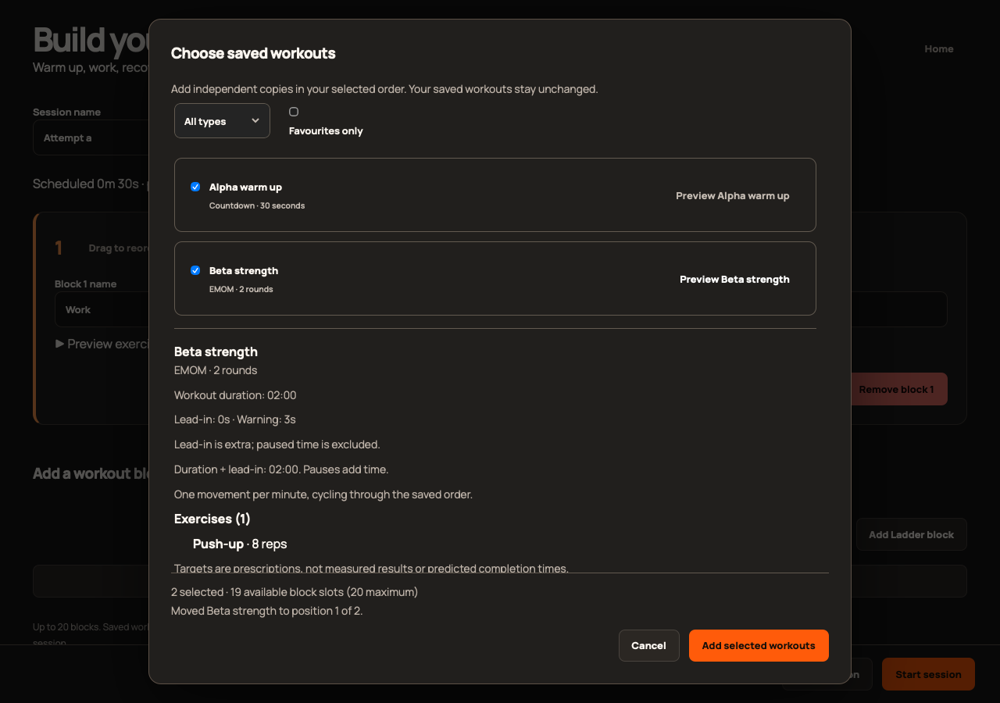

This 2.5.0 production WebKit capture uses isolated sample data.

## What you can do

- **Train through a complete session:** combine 1–20 blocks from all six workout modes, with warm-up, main work, recovery and cooldown. Choose automatic transitions or wait until ready. Save, duplicate, organise and share the whole routine.
- **Recover interrupted training:** multi-part sessions keep local checkpoints and recover paused, without counting time away. Review and save partial work or discard it explicitly.
- **Record what you did:** optionally enter actual reps, time, distance, calories and load with kg/lb units, separate from prescribed targets. Review each block under one session result, correct actuals and compare compatible attempts.
- **Protect your local data:** export a full backup in Settings, preview a restore before replacing data, and keep a rollback copy. Backups include private history and notes and are not encrypted. [Data and recovery details](docs/training-storage.md).

- **Choose from six workout modes:** EMOM, Countdown, work/rest Intervals, AMRAP, For Time and Ladder. Configure lead-in and warning cues, pause/resume, and follow large workout clocks. The Mac stays awake during an active workout.
- **Build your exercise order:** browse 323 bundled exercises, create personal movements, filter by equipment or focus area, drag to reorder, preview explained alternatives, replace a movement, and set supported repetition, time, distance or calorie targets. Targets guide planned work; they are not measured performance.
- **Generate a workout:** choose My favorites for explicitly starred movements, Most used for history-ranked movements, Try something new or Mix It Up, then choose the exercise count. Choose optional focus areas; any selected area can match. Focus, equipment preferences and workout compatibility apply together; review and adjust targets before starting.
- **Star exercises:** mark bundled or personal movements in the picker and combine Favourites only with search, equipment and focus filters. Exercise stars stay on your Mac, separate from saved-workout favourites and usage history.
- **Reuse your favourites:** save named workouts for all six modes, update, duplicate directly from Home, mark favourites, and filter by name and workout type.
- **Fit your available time:** apply a time budget to saved workouts. Duration or a finite time cap plus lead-in must fit; uncapped workouts are excluded while the filter is active. Pauses add time, and a cap is not a predicted finish time. Combine with collection, type, favourite and search filters.
- **Organise your routines:** create local saved-workout collections, assign a workout to multiple groups, and combine collection, type, favourite and exercise-detail search filters. Removing a collection keeps its workouts.
- **Take a workout with you:** export a saved workout to a JSON file, preview an imported file, and add an independent copy. Timing, movements and targets travel together; history, notes, preferences and favourites stay local. Export a complete named collection to transfer a routine with several workouts.
- **Review your training:** explicitly save completed results, review the performed workout, compare matching attempts, add searchable notes, or repeat a result from setup. Later exercise/template edits never rewrite historical snapshots.

### Find a saved routine faster

Sort saved workouts and training sessions by **Recently added**, **Name A–Z** or **Shortest duration**. Filters apply to both lists; clearing them keeps your selected sort. Unknown durations appear last, and a time cap is not a predicted finish time. Recently added follows saved insertion order, including older routines.

If a copied, imported, renamed or moved session is hidden by filters, the app explains why and offers **Show session — clear library filters**. This is explicit and keeps your current editor draft.

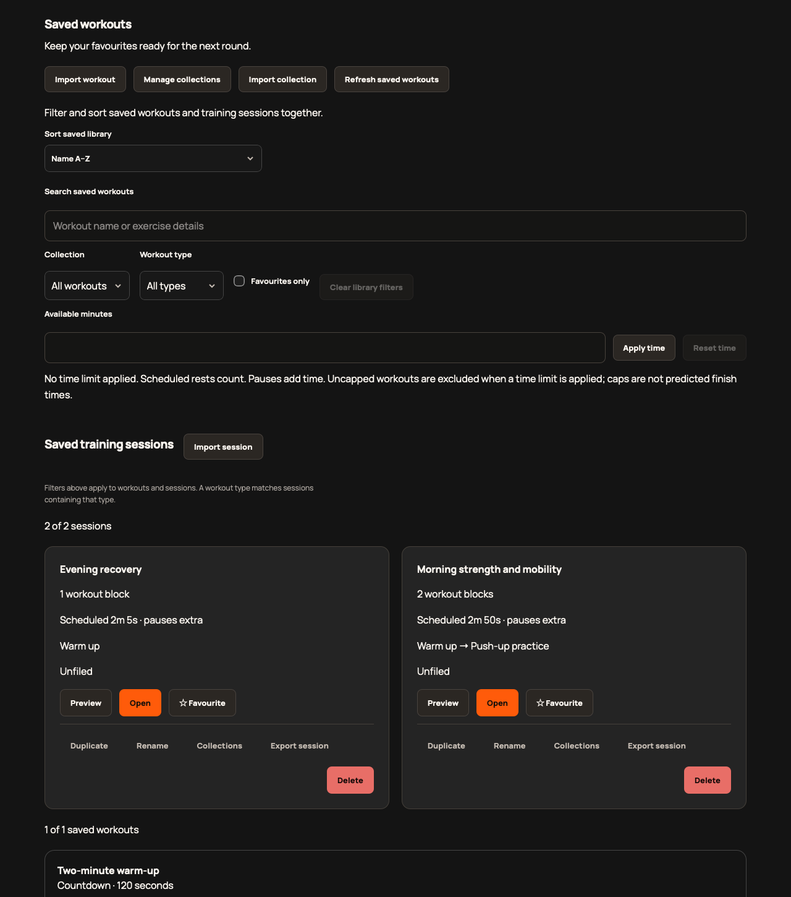

This 2.4.0 production WebKit capture uses sample data. Installed-app acceptance is tracked separately.

### Preview before opening a session

Choose **Preview** on a saved training session to inspect all blocks, movements, targets and transitions without replacing your draft. Opening the editor checks the latest saved version and asks before replacing an existing session draft. Manual waits and uncapped work are labelled honestly.

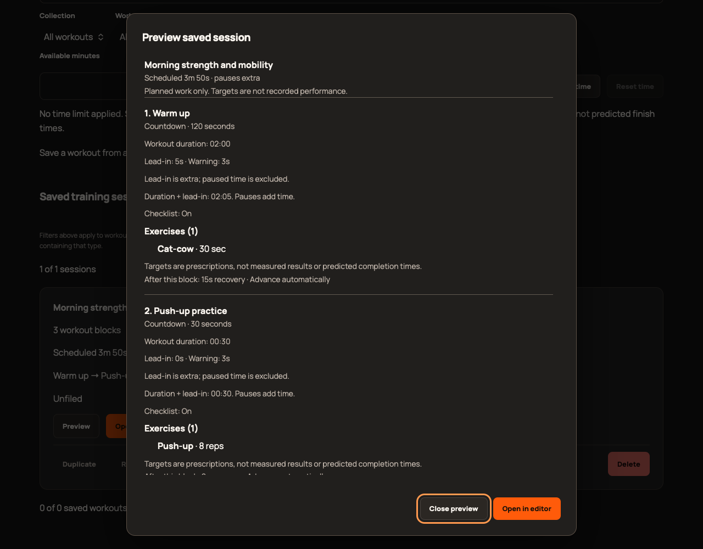

Workout and session cards share consistent action groups and filters. These 2.3.0 production WebKit captures use sample data; installed-app acceptance is tracked separately.

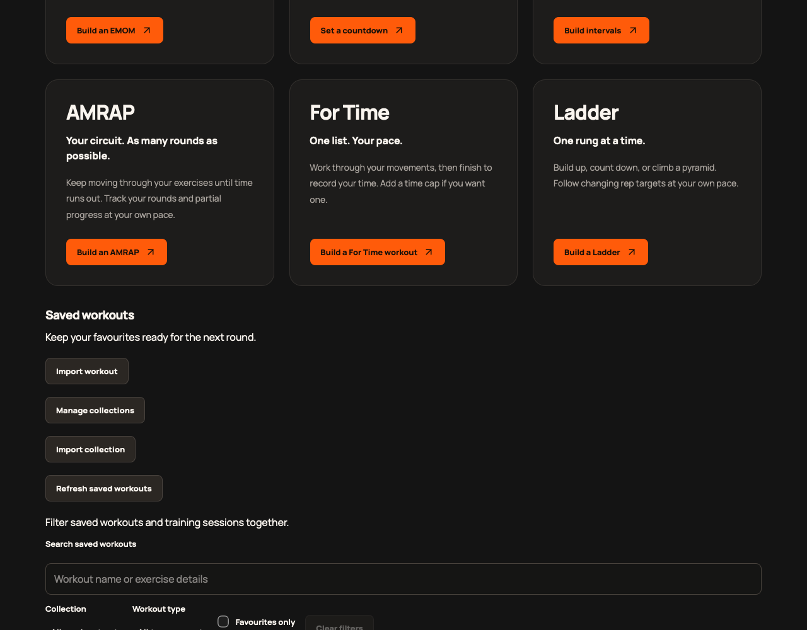

### Compare two session attempts

Open a saved session result in History and choose **Compare session results**. Pick Attempt A and B to inspect planned work and recorded performance. Matching complete prescriptions show neutral A-minus-B differences; changed or partial attempts can be inspected separately. Unknown load stays unknown, and zero remains a recorded value.

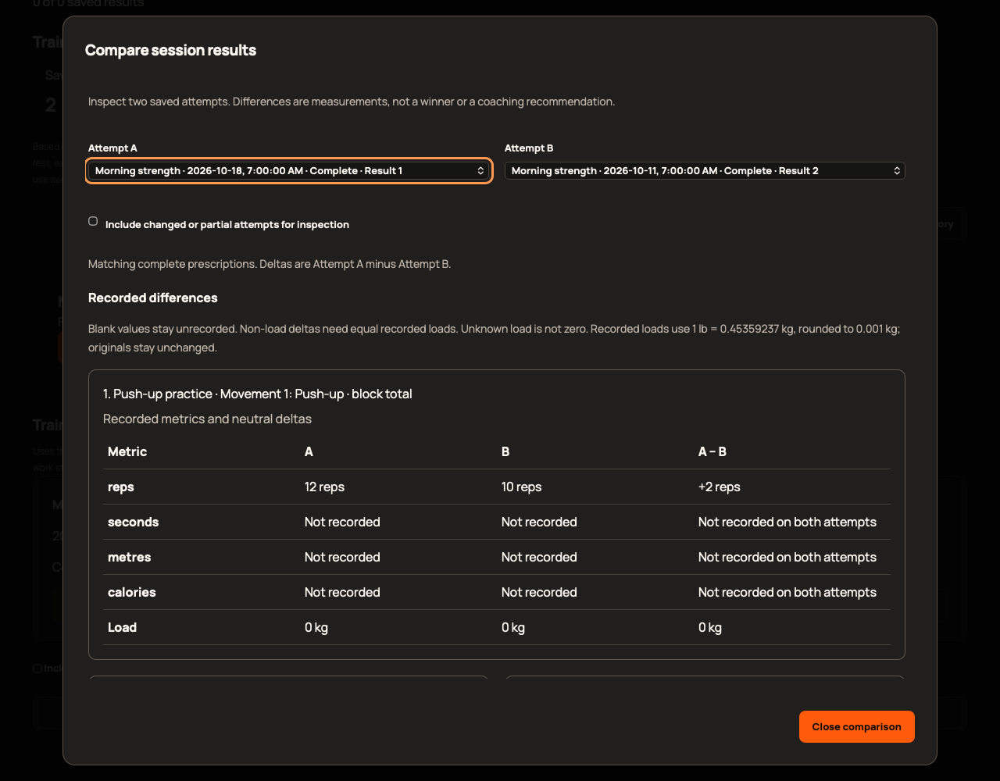

This 2.2.0 production WebKit screenshot uses sample results. Installed-app acceptance is tracked separately.

### Build a complete training session

Combine warm-up, main work and cooldown with recovery between blocks. Keep Save and Start within reach while arranging your routine.

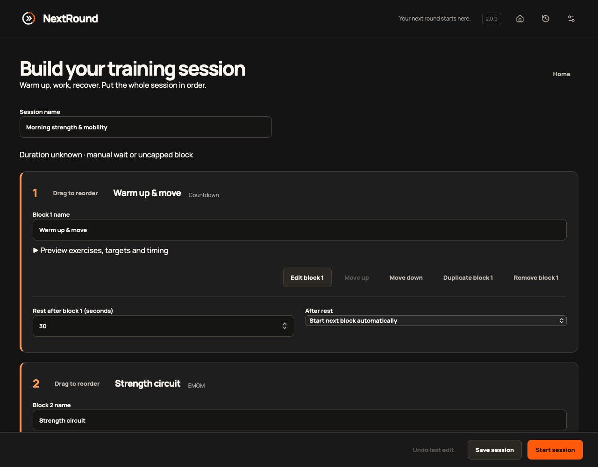

### Keep a full local backup

Export your supported local training data, preview a restore and review the previous restore copy.

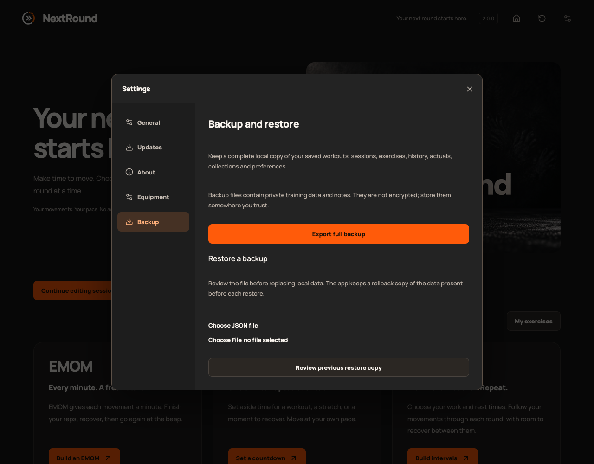

These 2.0.0 screenshots use sample data in the production WebKit build. Physical installed-app validation is recorded separately.

### Review exercise alternatives

See explained alternatives in Replace, review equipment and targets, then confirm the change. Undo restores the original slot while preserving other edits.

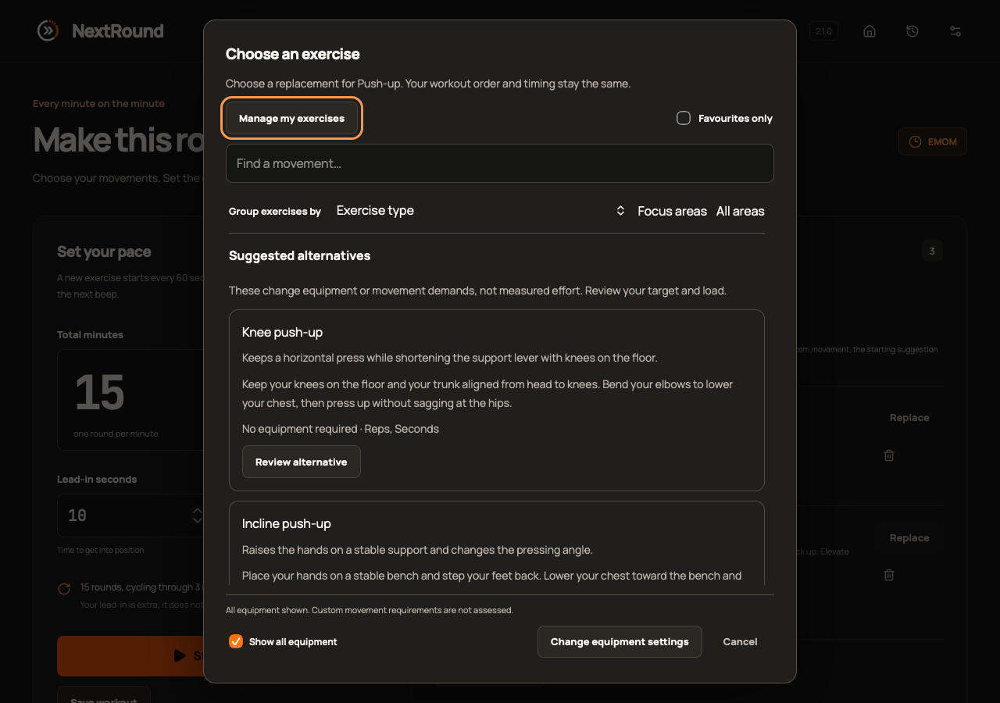

This 2.1.0 production WebKit screenshot uses the bundled library.

### Find a workout for your available time

Apply a minute budget alongside your saved-workout filters. The matching duration includes lead-in; capped sessions are clearly labelled, and pauses add time.

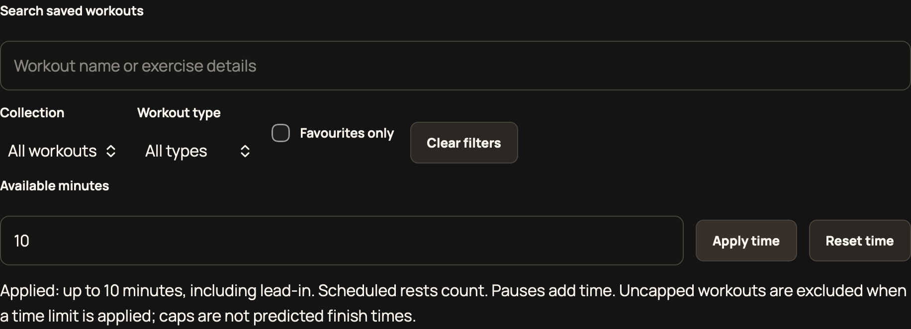

This 1.24.0 production WebKit screenshot shows the filter panel with sample data. Physical installed-app validation is separate.

### Generate for a focus area

Choose areas such as Core / abs or Legs in Create a workout. The eligible count reflects your areas, equipment and preset. Keep your chosen exercise count, timing and Undo; insufficient matches require an explicit adjustment. Focus selections last for the open generation flow, including equipment settings, and reset to All areas next time. Matching any selected area does not guarantee every area is represented.

### Share a workout collection

Export a complete routine and preview independent copies of every workout before adding them. Edit names to resolve collisions; imports either add the entire collection or leave the library unchanged.

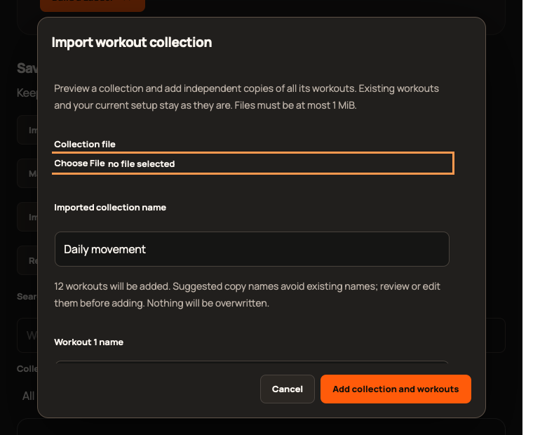

This 1.23.0 WebKit production-build screenshot shows sample data at 760×620. Physical Mac validation is separate.

### Organise saved workouts

Create collections such as Quick sessions or Kettlebell days. Choose **Collections** on a saved workout to assign it to one or more groups, or use **Unfiled** to find workouts without a collection. Single-workout imports and new saves start unfiled; duplicates keep their source memberships. [Collection details](docs/workout-collections.md).

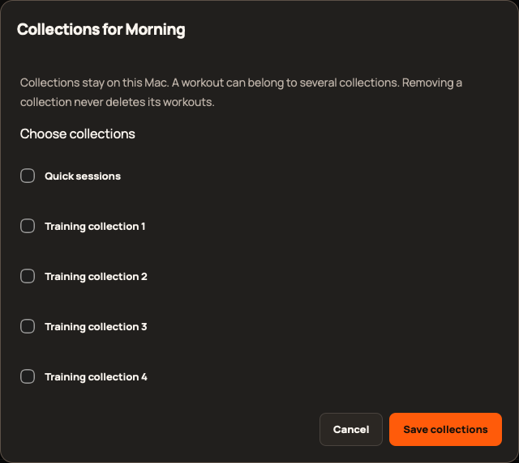

This 1.22.0 browser production-build screenshot uses sample collections at 760×620. The Mac was locked during capture; this is not a native installation screenshot.

### Portable saved workouts

Export one saved workout as JSON, or import a file and review its timing and movements before adding an independent copy. This works for all six workout modes and preserves your current setup.

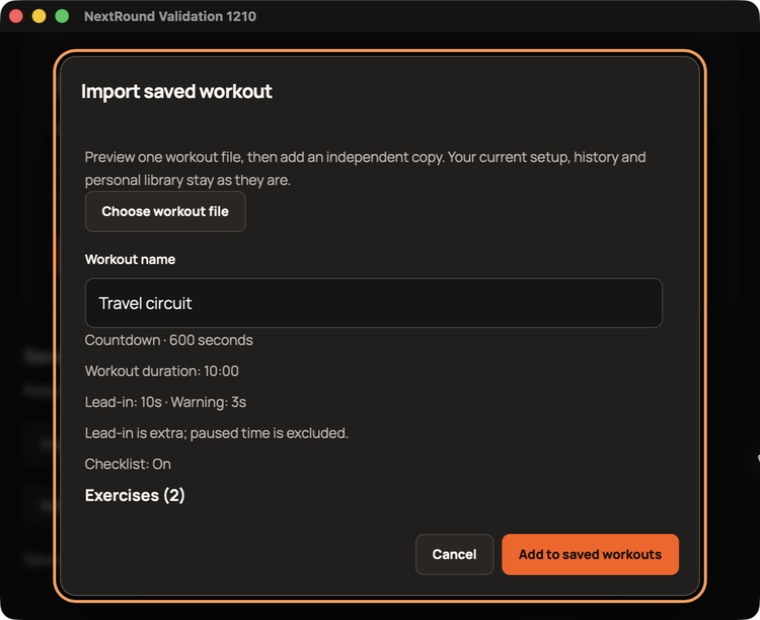

### Duplicate saved workouts

Duplicate saved workouts directly from Home to make independent, unfavourited variants without replacing your current setup. Saved-workout filters stay with you as you navigate during the app session.

### See your training summary

Workout History shows **Saved sessions**, **Workout time** and **Active days** for the same results as your applied date, workout-type and search filters. Workout time includes programmed rest and excludes pauses and lead-in; active days use local completion dates. These are saved-session totals, not measured exercise effort. Failed reads label previously loaded data instead of showing misleading zeros.

### Find history by date

Combine **All dates**, **Today**, **Last 7 days**, **Last 30 days**, or **Custom range** with workout type and exercise/description/note search. Presets count local calendar days including today. Custom dates include both endpoints; choose **Apply dates** to apply valid dates. Incomplete or invalid drafts leave the previous range applied and clearly displayed.

History filters survive navigation within the app session; restarting resets them. **Reset filters** clears everything. Relative presets refresh after local midnight and when returning to the app. Comparisons include all retained matching attempts regardless of list filters. Closing comparisons returns to the originating result, or safely to history if it was removed.

Export filtered history to a local CSV report, with workout notes included only when selected. [CSV details](docs/history-csv.md).

## Screenshots

The 1.13.0 interface, captured in the browser preview with sample data. The macOS app uses the same shared interface.

**Choose your workout.** Start with EMOM, Countdown, Intervals, AMRAP, For Time or Ladder.

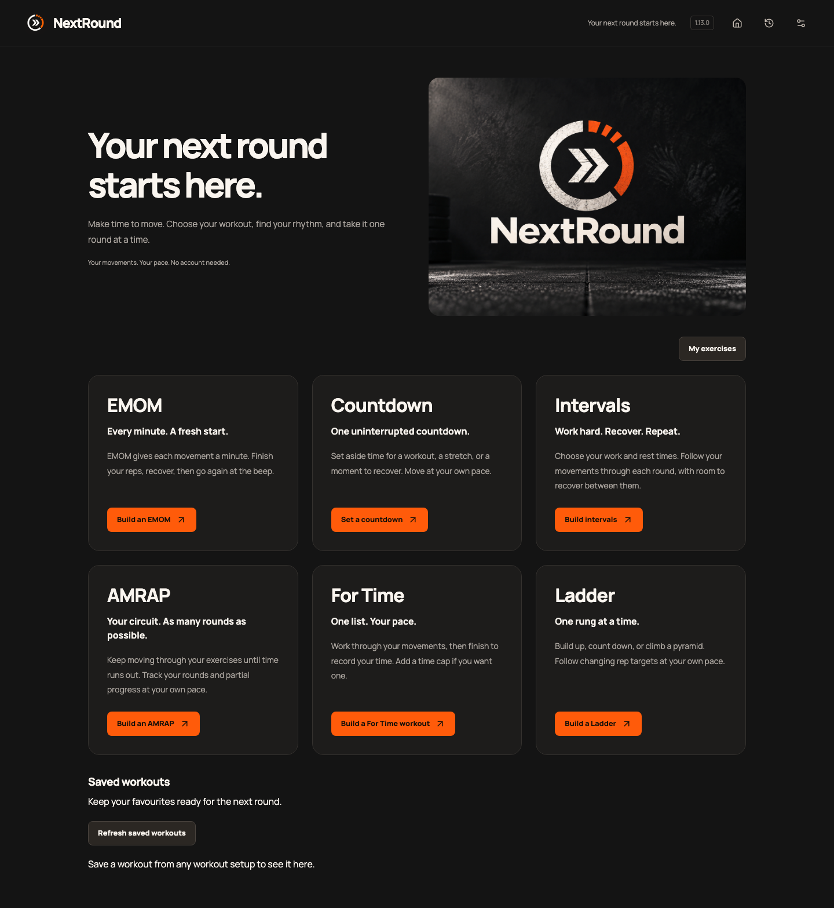

**Build your session.** Set the timing, arrange movements and adjust exercise targets.

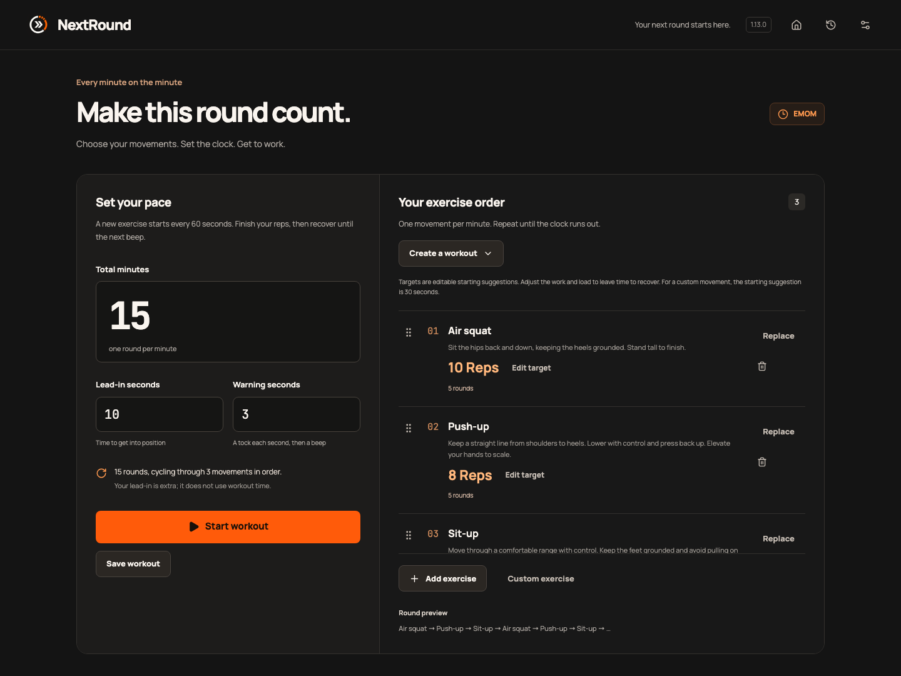

**Find your movements.** Browse exercise groups, use focus-area and equipment filters, or get suggestions from saved history.

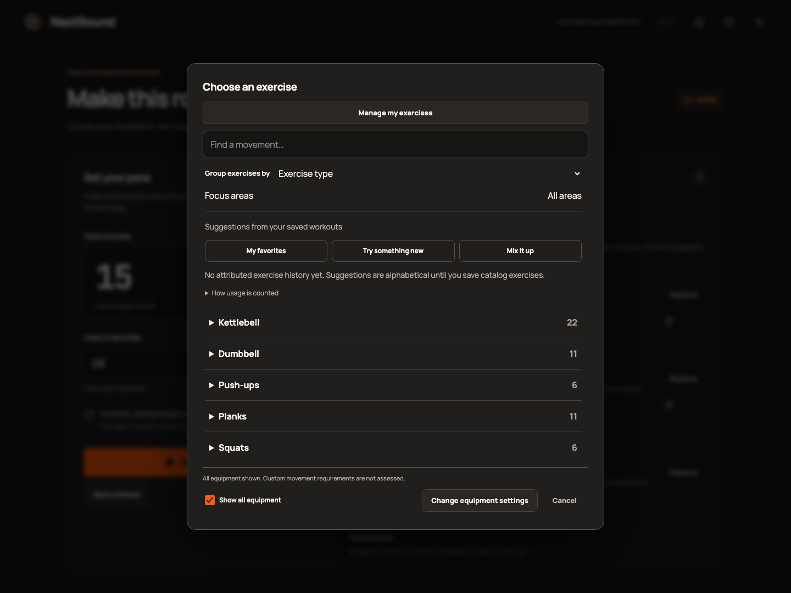

**Keep your movements handy.** Star exercises, then combine Favourites only with search and other filters. This 1.18.0 browser validation screenshot shows the picker at the minimum window size.

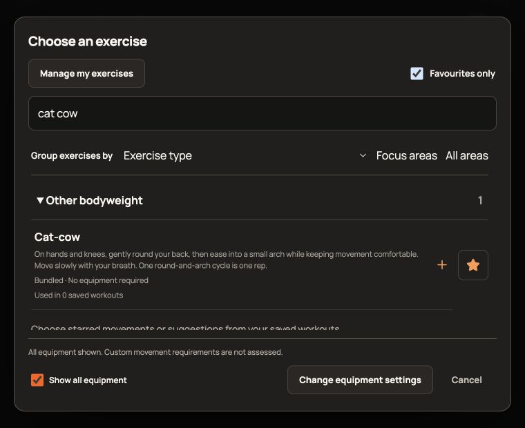

**Choose your focus.** The 1.19.0 generator combines focus areas with presets and equipment. This browser preview at the minimum window size shows sample selections and fixed action buttons.

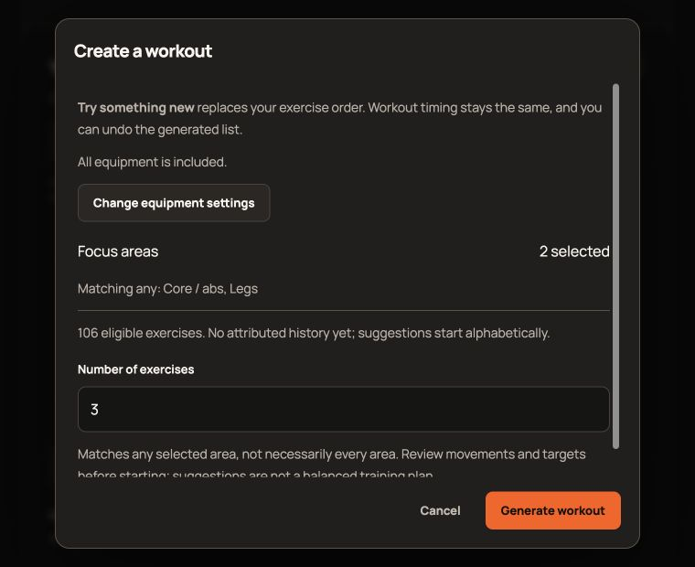

**Remember your progress.** Review completed sessions, add notes, compare attempts and repeat a workout from setup.

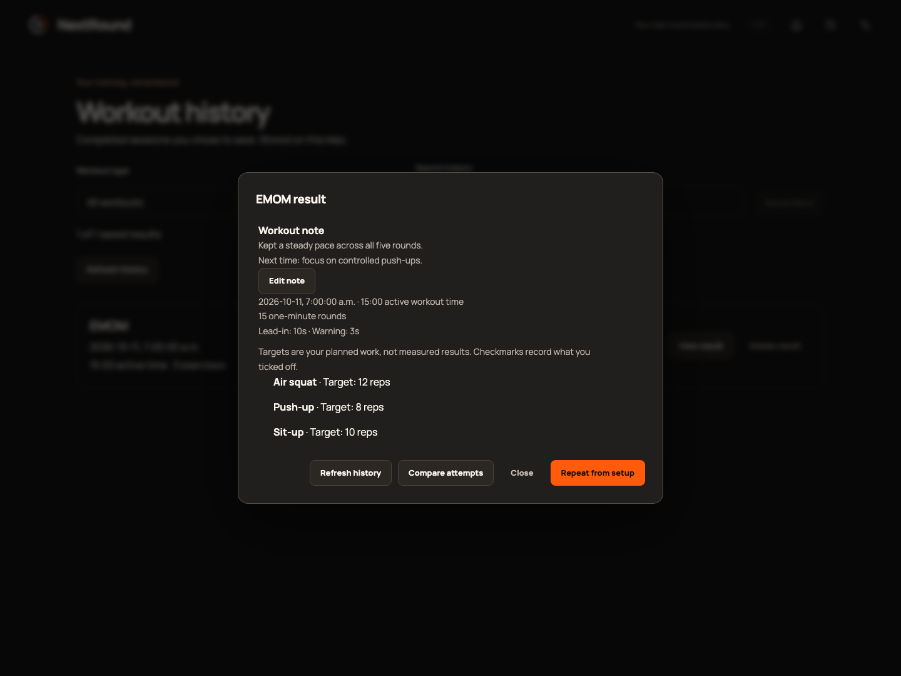

**Find the session you want.** Combine date ranges with workout type and text search. The date-filter view below is from the 1.14.0 browser preview with sample data.

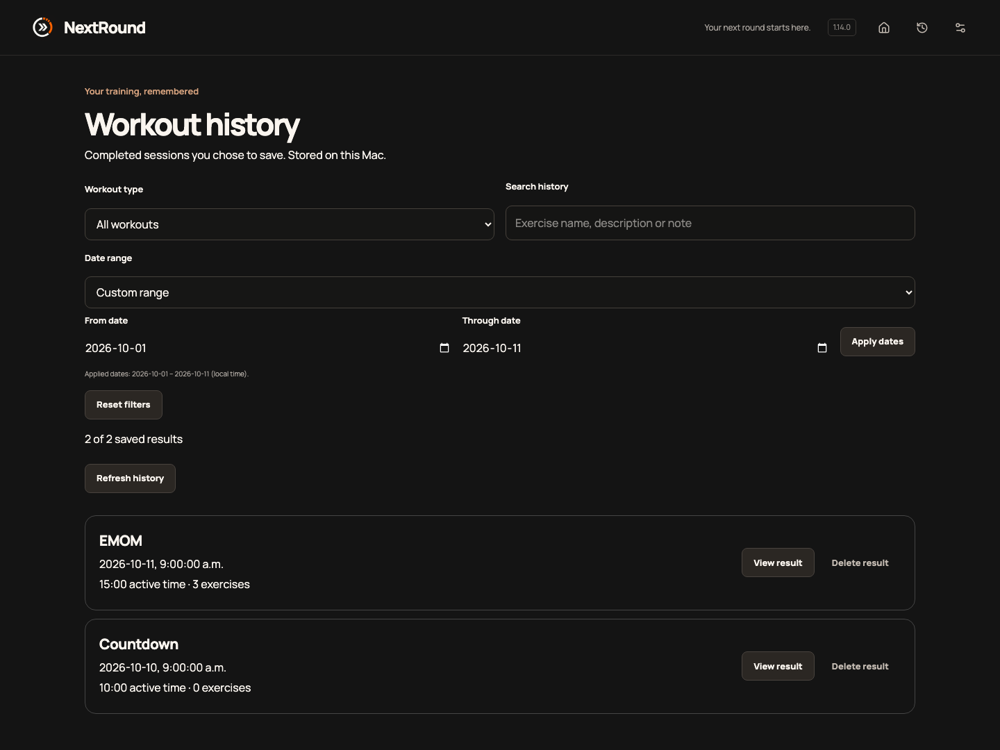

**See the bigger picture.** Training summary follows the applied history filters. This 1.16.0 screenshot shows the shared app interface in the browser validation build with sample sessions.

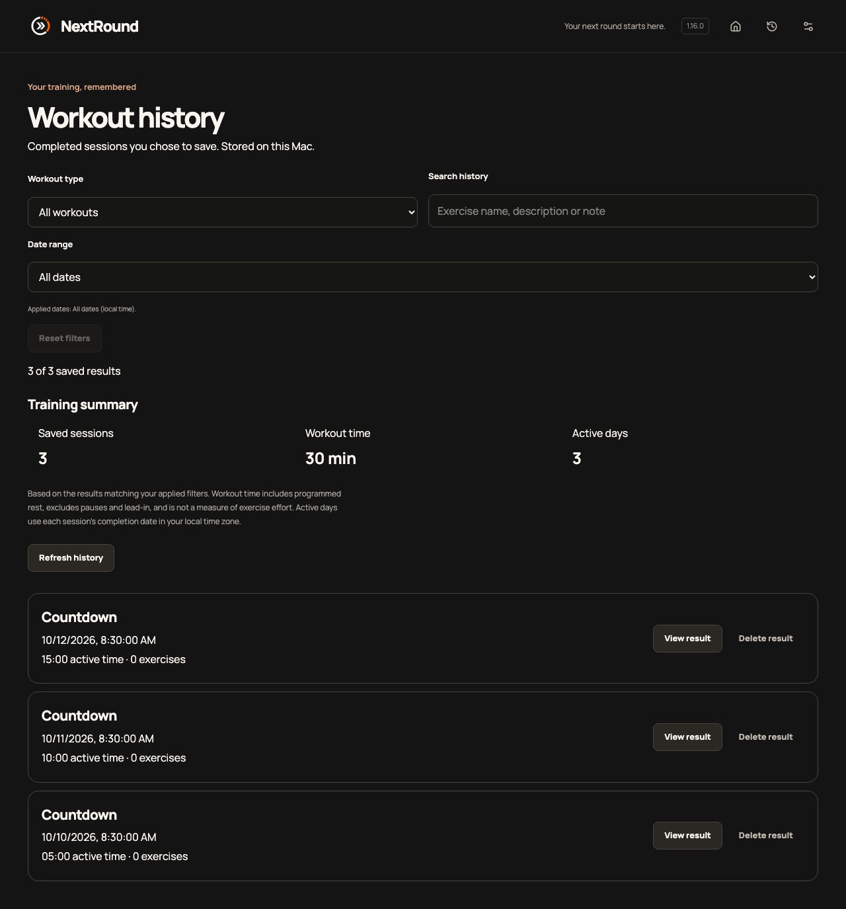

**Export a report.** Save the filtered sessions as a CSV, with notes included only when selected. This 1.17.0 browser validation screenshot uses a short sample session.

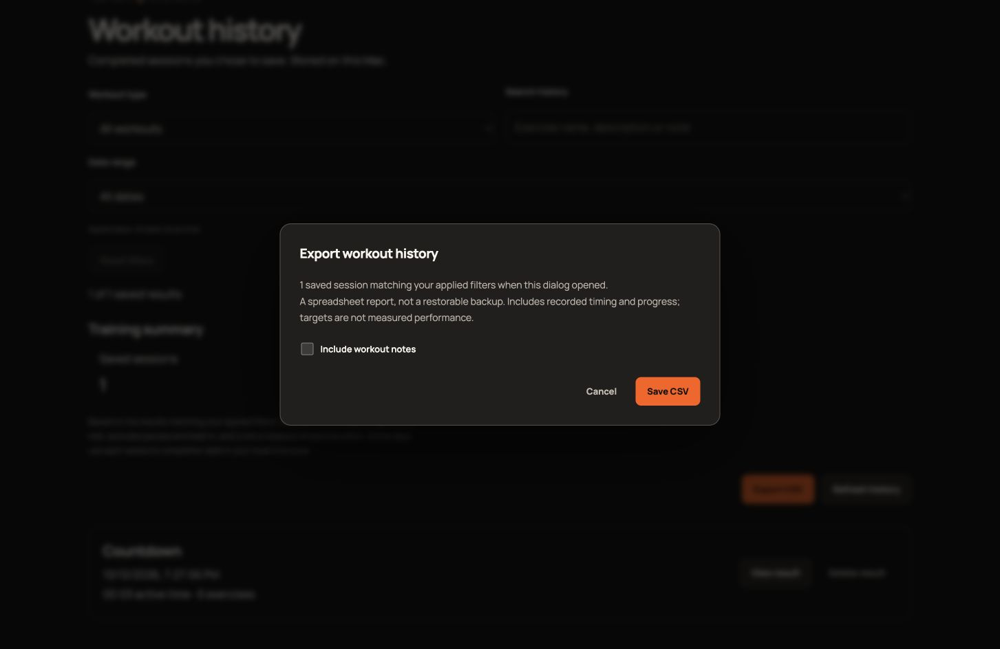

**Make a variation.** Duplicate a saved workout without replacing your current setup. This 1.15.0 screenshot was captured in the native macOS validation app with sample data.

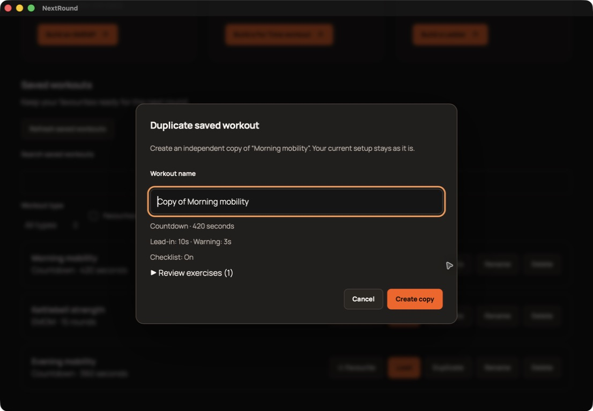

**Preview before loading.** Inspect a saved workout’s timing, movements and targets without changing your current setup. This physical Mac screenshot shows sample data at the minimum window size.

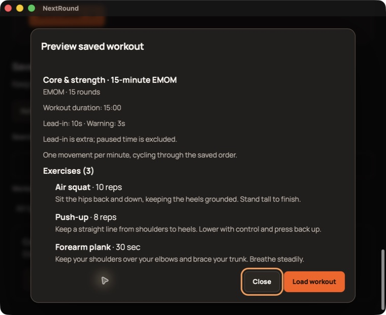


## Data and distribution

The macOS app stores versioned JSON documents with atomic native writes for workout history, saved templates and personal exercises. Core functionality works offline; there is no account, backend, cloud sync or AI service. Notes stay separate from scores, comparison matching and exercise usage. Only completed sessions explicitly saved by the user appear in history; interrupted-session crash recovery is not available.

GitHub downloads are Developer ID signed and notarized, with signed in-app updates. TestFlight/App Store builds update through Apple. The two distribution channels have separate local data; switching channels does not transfer your library or history. Updates do not install during an active workout or an unsaved result/note flow.

**Planned:** iOS support and validation, cross-device synchronization decisions, and recommendations matched to available time and desired intensity. These are not shipped features. The existing history-based exercise suggestions are heuristics, not personalized coaching.

## Development

NextRound uses a pnpm monorepo with a Tauri 2 macOS shell, React/TypeScript, Vite, Tailwind CSS, shadcn/ui components, Zustand, TanStack Router and TanStack Query. Shared workout types and validation live in `packages/core`; native timing, audio, storage and distribution adapters live in `apps/nextround/src-tauri`.

```text
apps/nextround/src/        React interface and feature integration
apps/nextround/src-tauri/  Native shell, timing, storage and packaging
packages/core/            Shared workout models and validation
docs/                     Product, release and validation documentation
```

Prerequisites: macOS 14 or later, Node 24.3.0 (`.node-version`), Xcode command-line tools and Rust via rustup. `rust-toolchain.toml` pins Rust 1.98.1. The Makefile bootstraps pnpm 12.8.1 through npm.

```sh
make install       # Install locked dependencies
make dev           # Run the macOS Tauri app
make dev-web       # Browser preview
make check         # Types, tests, native checks, lint and frontend build
make test-e2e      # Browser interaction tests
make build-app     # Local ad-hoc-signed app for testing
make build-macos   # Local app and DMG
```

Before browser tests, install Chromium with `npm exec --offline --yes --package=pnpm@12.8.1 -- pnpm exec playwright install chromium`. Native production timing/audio require the macOS app; browser preview is for interface development.

Local test builds are not public signed/notarized releases. See [contributing](CONTRIBUTING.md), [GitHub release instructions](docs/release.md) and [TestFlight packaging](docs/testflight-macos.md). PRs use required checks and the merge queue without required reviewer approvals.

## Further reading

- [1.24.0 release notes](docs/release-notes-1.24.0.md)
- [1.23.0 release notes](docs/release-notes-1.23.0.md)
- [1.22.0 release notes](docs/release-notes-1.22.0.md)
- [1.21.0 release notes](docs/release-notes-1.21.0.md)

- [1.19.0 release notes](docs/release-notes-1.19.0.md)
- [1.17.0 release notes](docs/release-notes-1.17.0.md)
- [History CSV export](docs/history-csv.md)
- [1.16.0 release notes](docs/release-notes-1.16.0.md)
- [1.13.0: workout notes](docs/release-notes-1.13.0.md)
- [1.12.0: saved-workout favourites](docs/release-notes-1.12.0.md)
- [Exercise sources](docs/exercise-sources.md) and [taxonomy](docs/exercise-taxonomy.md)
- [Brand artwork](assets/brand/README.md) and [icons](assets/icons/README.md)

Earlier version notes and validation records remain in [docs](docs/).
