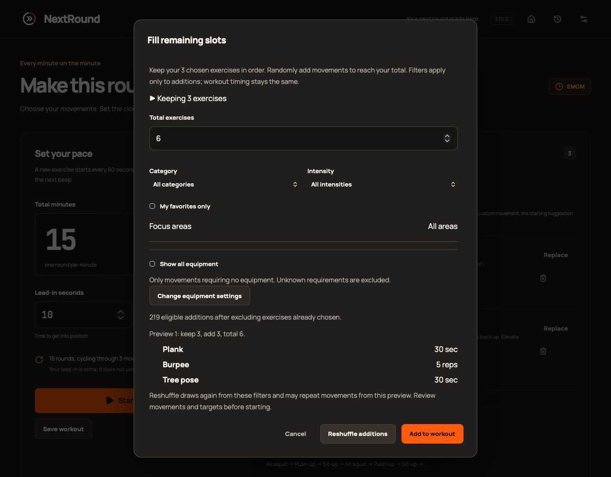
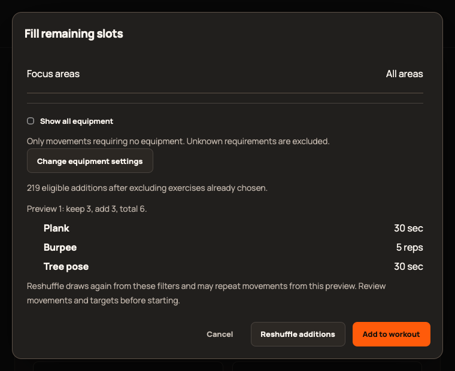

# 2.10.0 validation

Epic: [#425](https://github.com/StormKiln/NextRound/issues/425). Publication evidence: [#429](https://github.com/StormKiln/NextRound/issues/429).

Baseline: 375 unit tests passed. Random-fill operation tests failed before implementation, and the interval personal-target regression reproduced a 45-second default exceeding a 10-second phase. All 11 focused unit tests then passed. Initial browser regression failed at the missing action before UI implementation.

Independent design review covered stable content signatures, equipment null/empty semantics, permanent Undo invalidation and mode/work-phase preview safety. Implementation tests and final review/publication results are tracked on the issues. No physical observation is claimed from browser automation.

## Verified implementation
- 381 unit and 64 native tests; static/type/lint/release tooling and frontend build pass.
- Fourteen focused Chromium cases pass across six modes, session block capture, preview/reshuffle/apply/Undo, stale drafts, filter changes, load failures/retry, settings and 760×620 with enlarged text.
- Production WebKit: 66 cases passed; one existing keyboard test assumed plain Tab reached buttons. macOS WebKit uses Option-Tab for that navigation. A direct focus probe established the difference; the corrected test passed. Tracked as #431. No app behavior changed for this test correction.
- Native audio/power lifecycle, sandbox media smoke and local app packaging pass.
- Native UI on this Mac: launched local 2.10.0, previewed three additions, reshuffled, applied six exercises with original first three targets/order and timing intact, then Undo restored the original three. No saved workouts were modified. This was the locally built app, not the signed published artifact.
- Desktop and minimum-window production WebKit screenshots visually inspected: separated controls, readable preview and visible fixed actions.
- Independent implementation review of 49d1a6d found no actionable findings.

Full Chromium/hosted CI/merge queue and final signed artifact/Apple-processing evidence is recorded on #429 after completion. TestFlight upload/processing does not itself establish tester-group availability or a human VoiceOver audit.

