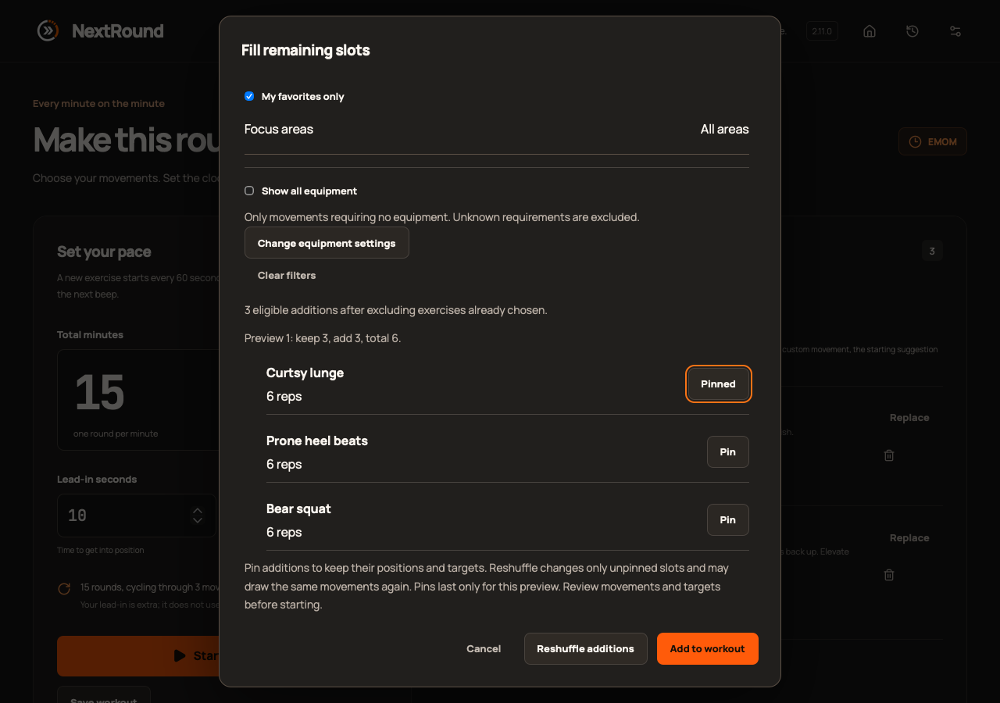
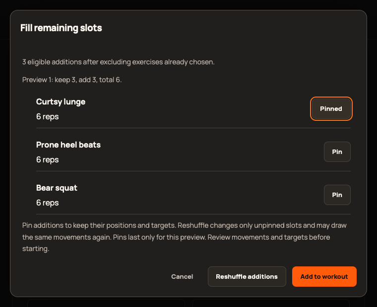

# 2.11.0 validation

Epic [#432](https://github.com/StormKiln/NextRound/issues/432); publication [#438](https://github.com/StormKiln/NextRound/issues/438).

Baseline: 381 unit tests pass. New sampling tests failed before implementation. Browser regressions reproduced the session-history Retry omission, missing count focus and source-change protection gap. Catalog test observed 403 rather than 423 before additions.

Initial focused verification: 386 unit tests and 22 Chromium checks pass, including pinning across six modes, Apply/Undo, filter reset, retry, source guard, settings and minimum-window controls. Full release checks, independent review and signed publication evidence are recorded on #438 as they complete. Browser checks are not physical-device observations.

Independent review of 7e76422 approved with no actionable findings. The obsolete-preview revival edge case was reproduced and fixed under #439; ten focused cases then passed. Production screenshots at desktop and 760×620 were visually inspected: clear movement/target/Pin separation and visible fixed actions.

Full source checks passed: 386 unit tests,64 native tests,type/lint/release tooling and production build. Native media lifecycle, four sandboxed cues/display assertion and local macOS packaging passed; App Store no-default-features compilation passed.

Production WebKit passed76 cases; the new keyboard/layout test initially searched for the old Pin accessible name after toggling to Unpin. The corrected assertion passed the focused rerun, including enlarged text and minimum-window geometry. No application change was needed. Native UI was attempted but the Mac was locked; any later physical observation is recorded on #438.
