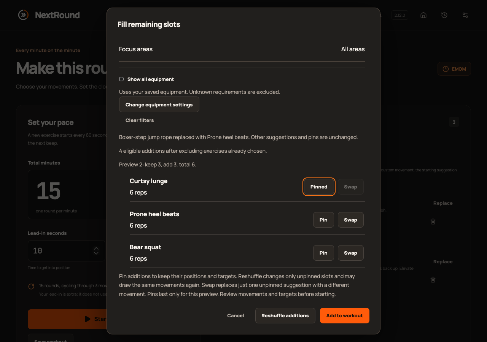
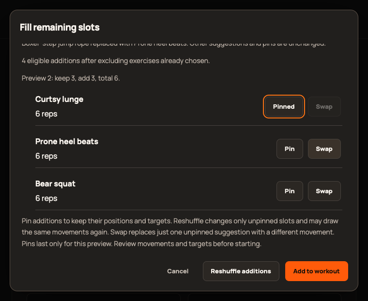

# 2.12.0 validation

Epic [#444](https://github.com/StormKiln/NextRound/issues/444); publication [#450](https://github.com/StormKiln/NextRound/issues/450).

The three pure swap tests failed before implementation, then passed. Four browser regressions reproduced stale-draft revival and incorrect numeric error semantics in both generation dialogs before the fixes. The catalog test observed 423 instead of 443 before additions. All 390 unit tests now pass.

Focused Chromium verification passed 21 checks: single-slot swapping across six modes, preserved pinned positions and neighboring targets, Apply/Undo, exhausted pools, session blocks, filter invalidation and minimum-window layout. An initial Undo test captured before hydration; waiting for the visible builder trigger corrected the test setup.

Production WebKit captures use isolated sample data. Full regression, native packaging, independent review and signed publication evidence are recorded on #450 as they complete. Browser checks do not establish physical-device observations.

Independent review of 81888bf found no Critical, Important or Minor issues. Full source checks passed: 390 unit tests, 64 native tests, type/lint/release tooling and production build. Full Chromium passed 432 cases. Native packaging, audio/power lifecycle, sandboxed cues/display assertion and App Store no-default-features compilation passed.

On the physical Mac, the locally built 2.12.0 app launched and the Countdown preview successfully pinned a movement, swapped a different slot, applied the reviewed list and restored the original empty list with Undo. No saved workout or history data was changed. This is a local build observation, not a downloaded upgrade or TestFlight tester installation claim.

Production WebKit initially exposed an incorrect test assumption that mouse clicks focus buttons. The exhausted-pool check now focuses Swap and activates it with the keyboard, explicitly testing preserved keyboard focus. Final rerun and publication results are attached to #450.

Final production WebKit evidence: 85 cases passed initially; all nine 2.12.0 cases passed on the corrected focused rerun. Final Chromium release/regression rerun passed all 13 cases. The only rerun change was keyboard activation in the test; application source remained the reviewed build.

Hosted CI completed its substantive checks but hit the 30-minute job limit during cache upload. Issue #453 increases the full-validation limit to 60 minutes, preserving required checks and the protected queue. Exact-head CI and queue reruns are required before tagging.
