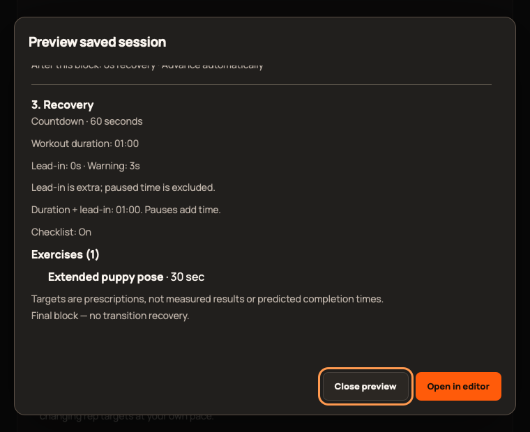

# 2.3.0 validation

Authoritative completion evidence: [release acceptance #349](https://github.com/StormKiln/NextRound/issues/349). Implementation branch: release/2.3.0. This document distinguishes automated evidence from physical acceptance.

## Regression work

- Initial browser regressions reproduced missing session preview, stale cached actions, and a 30-collection dialog with Cancel off-screen at 760×620 (#350).
- Focused coverage verifies preview immutability, saved change/deletion, draft cancellation, stale open/duplicate/export, successful refresh gates, 30-collection action reachability and nearby filter reset.
- Expanded coverage includes all six modes in a 20-block preview, manual waits/uncapped duration, final-block reachability, visible scrollbars and Escape focus restoration; existing picker/session/comparison regressions run alongside these.
- Catalog regression failed at 263 versus 283 before additions. The new catalog preserves all 263 prior entry snapshots and validates 10/5/5 equipment split, extra support requirements, metadata, targets, generation and Ladder compatibility.
- Release artifact contract regression reproduced same-name retry collisions. Diagnostics now retain each attempt; the stable verified artifact can be replaced after successful packaging and remains aligned with its download consumer. TestFlight already uses distinct run/attempt installer names.

- Final independent review reproduced empty edited draft replacement and false zero-match feedback when collection reads fail (#351). Both Open paths and Home now preserve meaningful drafts; collection-dependent result messages wait for successful reads. Geometry checks also reproduce/fix a shrunken session section and excessive toolbar rows.
- New result counts exposed ambiguous page-wide status selectors in nine older tests; those assertions now select the intended feedback explicitly.

## Acceptance status

`make check` passes: 314 unit tests, 64 native tests, release tooling, typecheck, lint/clippy and production build. Native media lifecycle, sandbox cues/wake assertions and Apple no-default-features compilation pass. Production WebKit passes all 31 scoped cases. The complete Chromium rerun is in progress; final results and immutable commit/run IDs are recorded in #349.

The equipment-footer keyboard check uses Option-Tab for macOS WebKit (plain Tab excludes non-text controls under the platform preference), and Tab for Chromium. Inspection confirmed focus stayed on Retry after activation, then Option-Tab reached the override checkbox; no application focus workaround was required. Workflow syntax validation passed with optional external shellcheck/pyflakes disabled after the local combined checker stalled; shell scripts are also checked by the release suite. Production screenshots use sample data. No storage schema changes are intended.

Computer-use reported the Mac locked during implementation. An unlock request is pending. Physical VoiceOver/keyboard, audible timing/sleep-wake, populated installed upgrade, TestFlight tester access and installed launch/persistence must be recorded separately. Older release acceptance issues are not closed by this release's automated evidence.

## Minimum-window production capture

Sample data in production WebKit at 760×620, with the overflowing session preview scrolled to its final block. Close/Open remain outside the scroll body.

