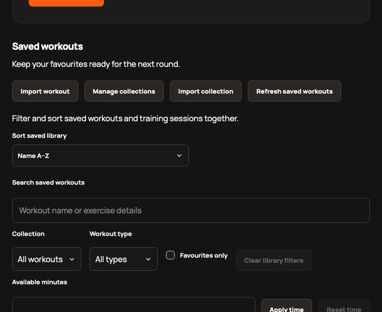
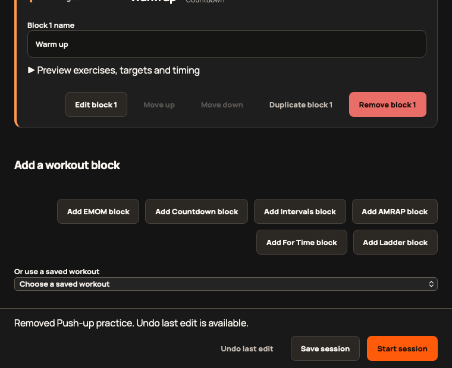

# 2.4.0 validation

Authoritative release status and immutable run/commit evidence: [#361](https://github.com/StormKiln/NextRound/issues/361). Scope: [epic #354](https://github.com/StormKiln/NextRound/issues/354).

## Regression evidence

- Sorting tests failed before the helper existed, then passed for recent/name/duration ordering, stable ties, unknown duration, immutability and sort-preserving filter reset.
- Browser tests reproduced an unexplained favourite-filter-hidden session copy and focus loss after final-block removal. Coverage now includes rename, collection moves, imports, durable-write failures, all three removal positions, transition preservation and Undo focus.
- The catalogue count test failed at 283 rather than 303, then passed after 20 additions. All 283 previous exercise records are preserved exactly; new metadata, equipment, targets and six-mode compatibility are checked.
- Four initial Rust setup tests failed before implementation. Retry, immediate success and final failure propagation pass. Independent review found legacy-tag recovery regression #362; a new executable temporary-git-checkout test failed then passed while verifying immutable source preservation.
- Production WebKit exposed undersized dropdowns despite min-height CSS (#363): 21px Sort and 25px Collection/Workout type. A page-only appearance correction yielded 44px or greater. The scoped correction disables native appearance only for these controls and supplies a visible chevron, retaining native select semantics.

## Verification

`make check` passes 317 unit tests, 64 native tests, release tooling, typecheck, lint/clippy and production build. The added recovery case brings Python release-tooling coverage to 35 tests; Node polling tests also pass. Workflow syntax validation passes with optional external shellcheck/pyflakes disabled after the local combined checker stalled. Shell syntax and behavior are independently checked by the release suite.

Native app build, audio/power lifecycle, sandbox four-cue/wake lifecycle and updater-free Apple compilation pass. A physical Mac launch shows 2.4.0, native sorting changes saved-workout order, and filter reset keeps Name A–Z selected. Existing installed templates/history/window preferences remain byte-identical after this read-only check. This is a local build, not proof of the final signed distribution upgrade.

The first full development-browser run overlapped Vite source reloads and was stopped after navigation resets. The stabilized-source Chromium run passed all 355 tests. Final focused Chromium coverage passed 26 cases. Production WebKit passed all 42 cases against the stable production build, including all six exercise pickers. An intermediate run overlapped production regeneration and hit a history lazy-load failure; the complete stable-build rerun passed. Production screenshots contain isolated sample data, not the user's records.

## Distribution and physical acceptance

Publication requires protected merge, tag v2.4.0, public signed/notarized GitHub assets and an Apple-processed TestFlight build. Final artifact/download/upgrade observations belong in #361. Automated media checks do not establish human-audible timing or full VoiceOver/sleep-wake acceptance; those observations must be recorded explicitly. Older release acceptance issues remain separate.

