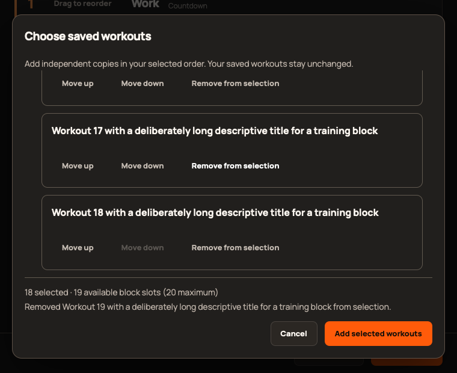

# 2.5.0 validation

Release status and immutable distribution evidence: [#373](https://github.com/StormKiln/NextRound/issues/373). Scope: [epic #365](https://github.com/StormKiln/NextRound/issues/365).

## Regression evidence

- The batch-selection helper first failed because it did not exist. It now validates fresh saved snapshots, rejects empty/duplicate/over-capacity/changed/deleted/invalid selections and returns independent ordered blocks. Mixed-mode coverage preserves all six configurations, exercise targets and ladder settings.
- A delayed-read component regression verifies that cancellation/unmount prevents a late append; a failed initial read can recover through explicit refresh and fresh selection.
- Browser tests first failed on missing chooser controls, shared-library labels, add/update copy and move/duplicate focus. These scenarios now pass, along with batch Undo, explicit refresh, deletion/read failures, filters, capacity and cancellation.
- Production WebKit reproduced 23px native session and actual-performance selects despite min-height. Scoped appearance/chevron styling now passes 44px geometry checks while retaining native select semantics.
- Production WebKit also reproduced lost focus after cancelling the chooser (#374). Explicitly focusing its invoking button before opening fixes Escape and Cancel return focus.
- Catalogue tests failed at 303 rather than 323, then passed after 20 additions. All 303 previous exercise records remain identical. New metadata, equipment, aliases, targets and six-mode compatibility pass.

## Verification status

324 unit tests and 11 production WebKit release cases pass. WebKit checks include 760×620 layouts, long selection lists, fixed footer visibility, focus, cancellation and actual-performance controls. Full repository checks, native app build, native audio/power lifecycle, sandbox media lifecycle and updater-free Apple compilation pass. Full browser validation is in progress; final evidence will be recorded in #373 before tagging.

## Physical acceptance

The physical Mac was locked during the initial UI attempt. Automated checks and production browser screenshots are not evidence of a final installed signed-app upgrade, human-audible timing, VoiceOver or sleep/wake behavior. Remaining physical checks are tracked separately in the linked release follow-up rather than reported as passed.

