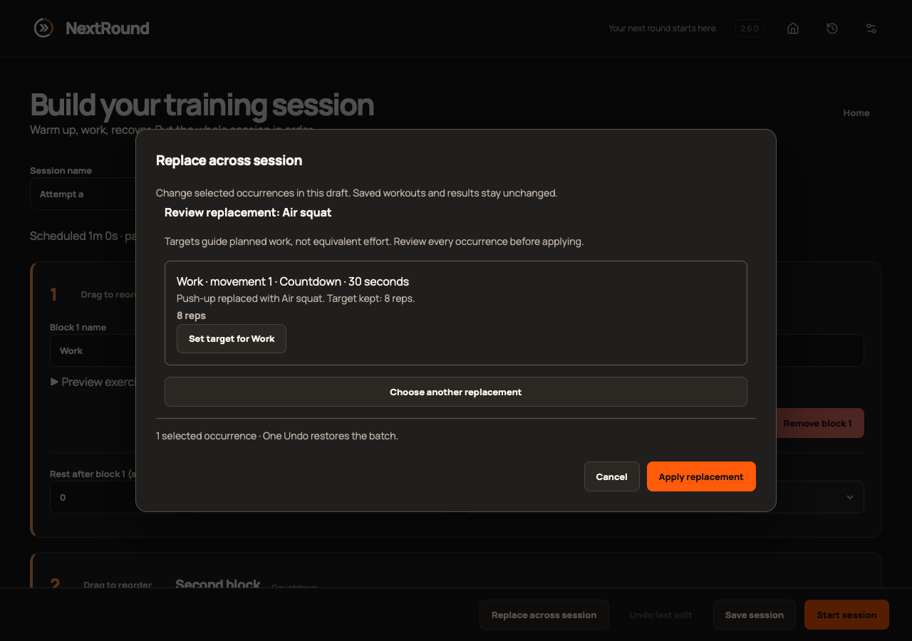
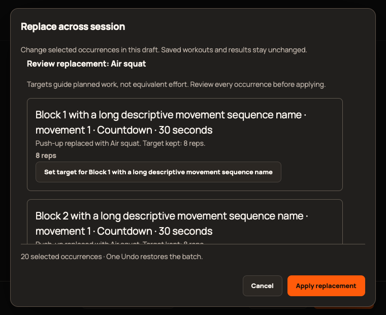

# 2.6.0 validation

Scope: [epic #377](https://github.com/StormKiln/NextRound/issues/377). Final immutable publication evidence belongs in [#384](https://github.com/StormKiln/NextRound/issues/384).

## Evidence so far

- Clean 2.5.0 baseline: 324 unit tests. Replacement helper tests first failed because the helper was absent; expanded suite passes 332 tests, covering selected occurrences, identity, immutable source/timing, invalid targets, stale drafts, all six modes and cancellation during a delayed personal-library read.
- Browser regression cases first failed on absent replacement/chooser actions. Seven focused production WebKit cases pass: subset Apply/Undo, source preservation, Cancel/focus, chooser filter/preview recovery, stale personal replacement refusal, explicit target edit and minimum-window control geometry, and a 20-block review with 20px text and visible scrollbars.
- Two initial WebKit failures were test selectors: a concatenated accessible name and a comparison action inside a result dialog. Corrected tests follow the actual visible flow and pass.
- Catalog count test failed at 323 before additions, then passed at 343. All prior exercise snapshots remain identical; equipment, aliases, defaults and supported workout modes pass.

Full repository checks, native audio/power and sandbox lifecycle, local native packaging and updater-free Apple compilation pass. Independent review found one race (#385): target editing remained enabled during Apply’s fresh personal-library read. A delayed-read test reproduced it; disabling editing during Apply fixes it and the 332-test unit suite passes. Broader browser regression and signed publication are pending; final results belong on #384 before tagging.

## Physical acceptance

Browser/native automation does not prove an installed signed upgrade, human-audible cues, VoiceOver or sleep/wake observations. Attempt physical checks and explicitly link any unavailable observations to an open follow-up with the published build identity.

These are production WebKit captures using isolated sample data, not installed signed-app evidence.
