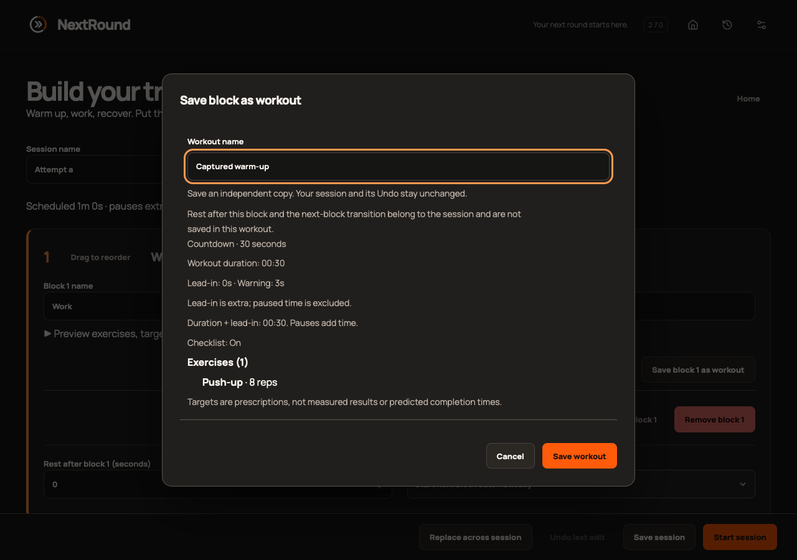
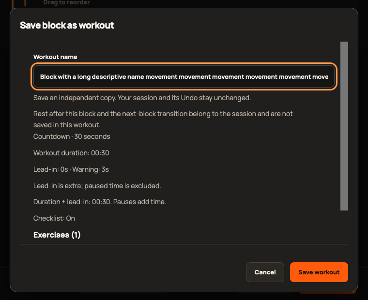

# 2.7.0 validation

Scope: [epic #388](https://github.com/StormKiln/NextRound/issues/388). Final immutable publication evidence belongs in [#395](https://github.com/StormKiln/NextRound/issues/395).

The baseline passed 332 unit tests. New behavior was exercised before implementation: missing save dialog, replacement selection with no occurrences, ambiguous positions, absent equipment status and missing catalog entries. The expanded suite passes 344 tests, including independent persistence for all six modes, stale block refusal, failed-write recovery and duplicate-submit prevention and unmount-before-dispatch cancellation. All previous 343 catalog records remain unchanged; the catalog now has 363.

Twelve focused Chromium cases pass for save/reveal/reload, cancellation, invalid names, replacement selection, nested equipment settings, keyboard focus and fixed actions at 760×620 with 20px text and visible scrollbars. Full checks and publication evidence are recorded on #395 as they complete.

Browser captures use isolated sample data and do not establish physical-device acceptance. Installed signed upgrade, audible cues, VoiceOver and sleep/wake observations require separate evidence; any unavailable checks must remain explicitly tracked.

Independent review found no blocking issues. Native tests (64), media/power and sandbox lifecycle, local macOS packaging, updater-free Apple compilation, typecheck, lint/clippy and production build pass. Five focused production WebKit cases pass; screenshots were visually inspected at minimum and desktop sizes. The Mac was locked on attempted native UI access; no physical acceptance is claimed.

The full Chromium run initially had 377 passes and one failing drag test. Event instrumentation proved no native dragstart occurred when the test scrolled its target before the first movement. #400 corrects that interaction, tests pointer drag plus keyboard activation at both sizes, and changes no product behavior. Two focused production WebKit cases pass; the full Chromium rerun and final immutable evidence are on #395.
