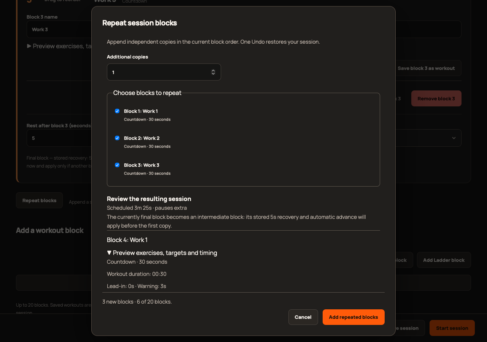
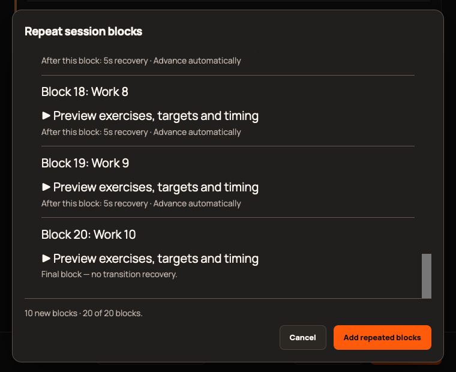

# 2.8.0 validation

Scope: [epic #401](https://github.com/StormKiln/NextRound/issues/401). Immutable publication evidence is recorded on [#408](https://github.com/StormKiln/NextRound/issues/408).

The baseline passed 344 unit tests. Repeat helper and editor transaction tests were observed failing before implementation. The expanded suite passes 365 tests: selected source order, additional copies, independent nested configurations for all six modes, fresh identities, exact capacity, invalid counts/selections, stale snapshots and active ownership. A committed catalog baseline preserves all 363 old exercise records; the library now has 383.

Focused browser coverage checks Apply/Undo, source preservation, capacity, cancellation/focus, inline accessible errors, positional transition labels, ready transitions, save/reload, empty selection, fractional counts and a 20-block preview at 760×620 with 20px text and visible scrollbars. Final-block recovery controls remain editable and explicitly explain that they apply only when another block follows.

Full Chromium, production WebKit, native media/power, sandbox, packaging, static checks and independent review evidence will be recorded on #408 as completed. Browser captures use isolated data and do not establish physical-device acceptance. Audible cues, VoiceOver, sleep/wake and installed signed upgrades require separately observed evidence.

Independent review found two ownership defects, tracked in #409: handled completed/cancelled snapshots incorrectly blocked session operations, while a pending standalone start was not guarded. A shared predicate now distinguishes live/pending work from retained finished snapshots in the library, preview and editor. Regression tests reproduced the failures, then passed: 365 unit tests and seven focused Chromium flows, including completed workout → saved result → open session → repeat → save block.

Local native 2.8 UI validation observed version display, a repeated countdown preview (14 seconds including lead-ins/recovery), Apply, Undo and successful completion of both five-second blocks. The temporary result was discarded; existing saved workouts remained intact. Native audio/power lifecycle and sandbox media checks passed with macOS hardware access. This is local-build evidence, not a signed-installed upgrade or human auditory/VoiceOver acceptance claim.

The independent re-review confirmed #409 resolved with no remaining blockers. Final full static/native checks pass (365 unit,64 native); the local package and updater-free Apple compilation succeed. Final Chromium/WebKit results and signed artifacts are recorded on #408.

Seven final production WebKit feature/lifecycle cases pass. Desktop and minimum-window captures were visually inspected for readable text, separated controls, scroll gutters and reachable footer actions.

