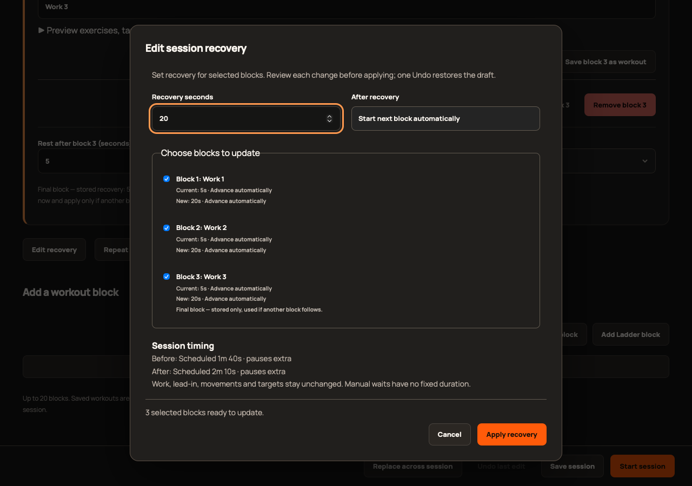
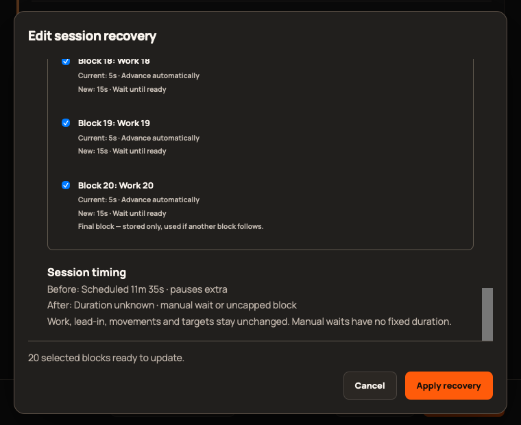

# 2.9.0 validation

Scope: [epic #412](https://github.com/StormKiln/NextRound/issues/412). Final publication evidence: [#419](https://github.com/StormKiln/NextRound/issues/419).

Baseline: 365 unit tests. Recovery operation/editor tests observed failing before implementation. Expanded suite: 373 unit tests, including preserved 383-record baseline and 403-entry catalog. Focused Chromium: 13 cases pass across 2.8/2.9, covering Apply/Undo, source preservation, invalid/empty selection, incomplete draft repair, cancellation/focus, persistence, capacity, long text and 760×620 layouts.

Full Chromium, production WebKit, static/native/media/sandbox and artifact checks remain to be recorded on #419. Production browser captures use isolated sample data and do not establish physical signed-install, VoiceOver, human-auditory or TestFlight tester-access acceptance.

Independent review found two defects, filed as #420: deferred native saves could leave stale conflict baselines, and refused edits could retain success feedback. Deferred-write and real-store UI regressions reproduced them, then passed after fixes. Follow-up review found no related blockers. The final unit suite has 375 tests; focused review UI checks pass seven cases.

Static checks, 64 native tests, native audio/power lifecycle, sandbox media smoke, local ad-hoc app packaging and updater-free Apple compilation passed. Six production WebKit feature/capture cases passed; desktop and minimum-window screenshots were visually inspected. Native UI interaction was attempted but the Mac was locked; remaining installed-distribution/accessibility observations are tracked in #421.

